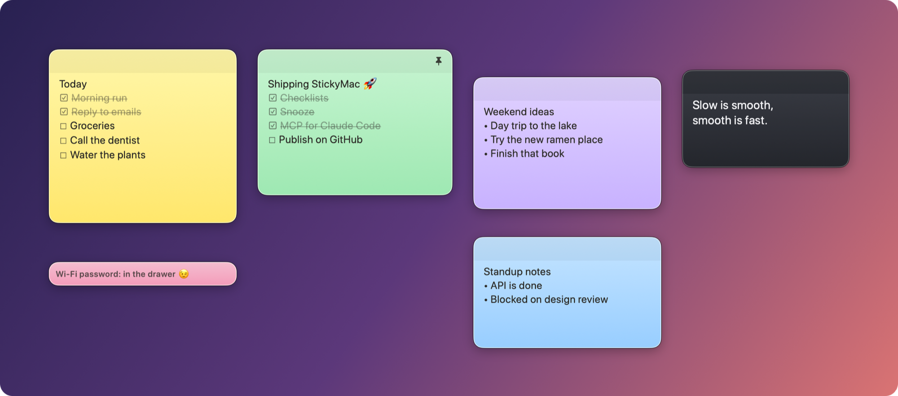

# StickyMac

**Sticky notes for macOS that your AI agents can write on too.**

Native, tiny (≈2k lines of Swift, zero dependencies), lives in the menu bar, needs no permissions and no account. Notes float on your desktop, turn into checklists, snooze until later — and Claude Code (or any MCP client) can create and tick them off while it works.



## Features

- **Instant capture** — `⌃⌥N` from any app opens a note at your cursor; `⌃⌥V` turns the clipboard into a note.
- **Checklists** — type `[]` + space for ☐, click to tick ☑, Enter continues the list. `- ` + space makes a bullet.
- **Snooze** — 💤 hides a note for 30 min, a few hours, until tomorrow or next Monday; it pops back in front when it's due.
- **Search** — `⌃⌥F` opens a Spotlight-style finder across every note, snoozed ones included.
- **Pin** — 📌 floats a note above every window, on every Space, even over full-screen apps.
- **Seven colors**, collapsible notes, adjustable text size, undoable delete (`⌘⇧T`).
- **Plain files** — optionally keep a Markdown copy of every note in a folder you choose (e.g. iCloud Drive or an Obsidian vault). Export a single note with `⌘E`.
- **AI-ready** — built-in [MCP](https://modelcontextprotocol.io) server and CLI so agents can leave you notes and to-do lists.

## Install

Requires macOS 14 Sonoma or later. Runs natively on Apple silicon and Intel Macs.

Download `StickyMac.zip` from the [latest release](https://github.com/ferax564/stickymac/releases/latest), unzip it, and move `StickyMac.app` to Applications. Releases are signed with a Developer ID and notarized by Apple.

To build from source instead, install the Xcode command line tools (`xcode-select --install`):

```sh
git clone https://github.com/ferax564/stickymac.git
cd stickymac
./build.sh --install   # builds StickyMac.app, copies it to /Applications and launches it
```

Look for the note icon in the menu bar. Turn on **Launch at Login** from its menu.

Optional: put the CLI on your `PATH`:

```sh
ln -s /Applications/StickyMac.app/Contents/MacOS/StickyMac /usr/local/bin/stickymac
```

## Keyboard shortcuts

| Anywhere | |
|---|---|
| `⌃⌥N` | New note at the cursor |
| `⌃⌥V` | New note from clipboard |
| `⌃⌥F` | Search notes |

| In a note | |
|---|---|
| `⌘N` / `⌘W` | New note / delete note |
| `⌘⇧T` | Restore last deleted note |
| `⌘⇧L` / `⌘⇧U` | Make checklist / check-uncheck |
| `⌘1`…`⌘7` | Color |
| `⌘⇧P` | Pin on top |
| `⌘M` | Collapse / expand (or double-click the top bar) |
| `⌘=` `⌘-` `⌘0` | Text size |
| `⌘K` | Search · `⌘F` find in note · `⌘E` export as Markdown |

## Use with Claude Code and other AI agents

The app binary doubles as an MCP server. Register it once:

```sh
claude mcp add --scope user stickymac -- /Applications/StickyMac.app/Contents/MacOS/StickyMac mcp
```

Then just ask:

> *"Make me a pinned checklist of the steps for this migration and tick them off as you go."*
>
> *"Leave me a note with the three things I need to review tomorrow."*

For Claude Desktop, Cursor and other MCP clients, add this to their MCP config:

```json
{
  "mcpServers": {
    "stickymac": {
      "command": "/Applications/StickyMac.app/Contents/MacOS/StickyMac",
      "args": ["mcp"]
    }
  }
}
```

| Tool | What it does |
|---|---|
| `list_notes` | All notes, newest first, with checklist progress |
| `search_notes` | Notes containing all the given words |
| `read_note` | One note by id |
| `create_note` | New note (text, optional color, pinned) — appears on screen immediately |
| `update_note` | Replace or append text, tick items, recolor, pin |
| `delete_note` | Delete (restorable with `⌘⇧T`) |

Notes go in and out as Markdown: `- [ ] todo`, `- [x] done`, `- bullet`.

### CLI

Handy for scripts and hooks:

```sh
stickymac new "Call the bank"            # prints the new note's id
git log --oneline -5 | stickymac new     # note from stdin
stickymac append 1a2b3c4d "- [ ] one more thing"
stickymac list
```

The CLI and MCP server talk to the running app over a Unix socket in `~/Library/Application Support/StickyMac/` (readable only by your user; nothing listens on the network). If the app isn't running they start it in the background.

## Your data

Notes live in `~/Library/Application Support/StickyMac/notes.json`, saved half a second after you stop typing. The menu bar menu has **Show Notes File in Finder**. Markdown copies, if enabled, are one-way: StickyMac writes them, but edits to the `.md` files are not read back.

## How it's built

AppKit + SwiftUI, Swift Package Manager, no third-party code.

| File | |
|---|---|
| `AppDelegate.swift` | Menu bar item, menus, hotkeys, note lifecycle |
| `NoteWindow.swift` | Borderless note window: pin, collapse, snooze, delete |
| `NoteView.swift` | Note chrome: header, color dots, footer |
| `NoteTextView.swift` | `NSTextView` editor with checklists and bullets |
| `NoteStore.swift` | Models and JSON persistence |
| `SearchPanel.swift` | Spotlight-style search |
| `AgentServer.swift` | Unix-socket API used by the CLI and MCP server |
| `CLI.swift` | `stickymac` CLI and MCP stdio server |
| `MarkdownMirror.swift`, `Snooze.swift`, `HotKey.swift`, `NoteColor.swift` | Small helpers |

`./build.sh` compiles a release build and wraps it into `build/StickyMac.app` (ad-hoc signed; the icon is drawn by `scripts/make-icon.swift`).

## License

MIT
